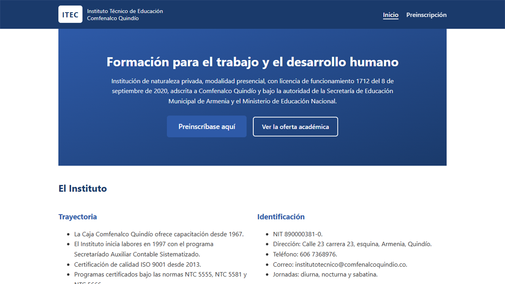
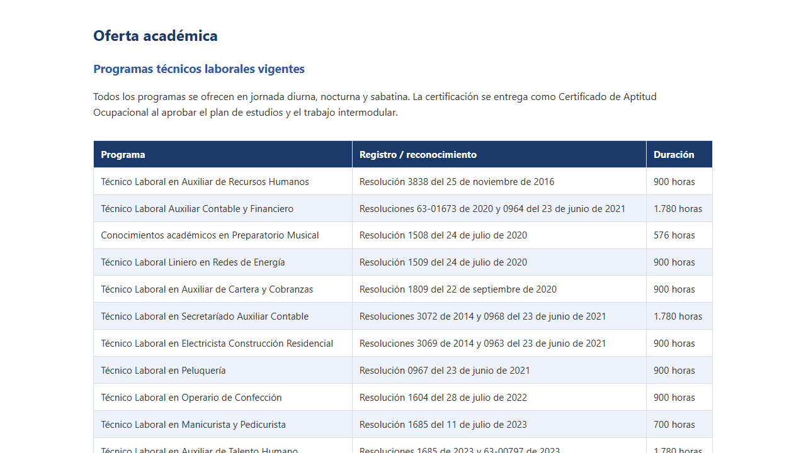
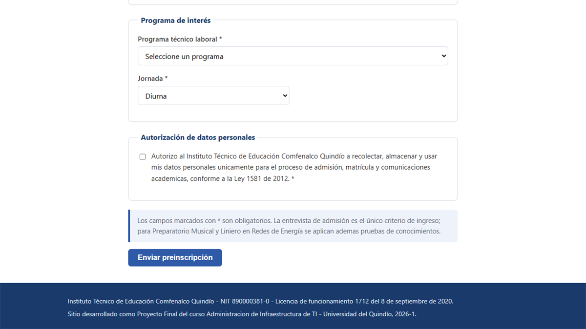
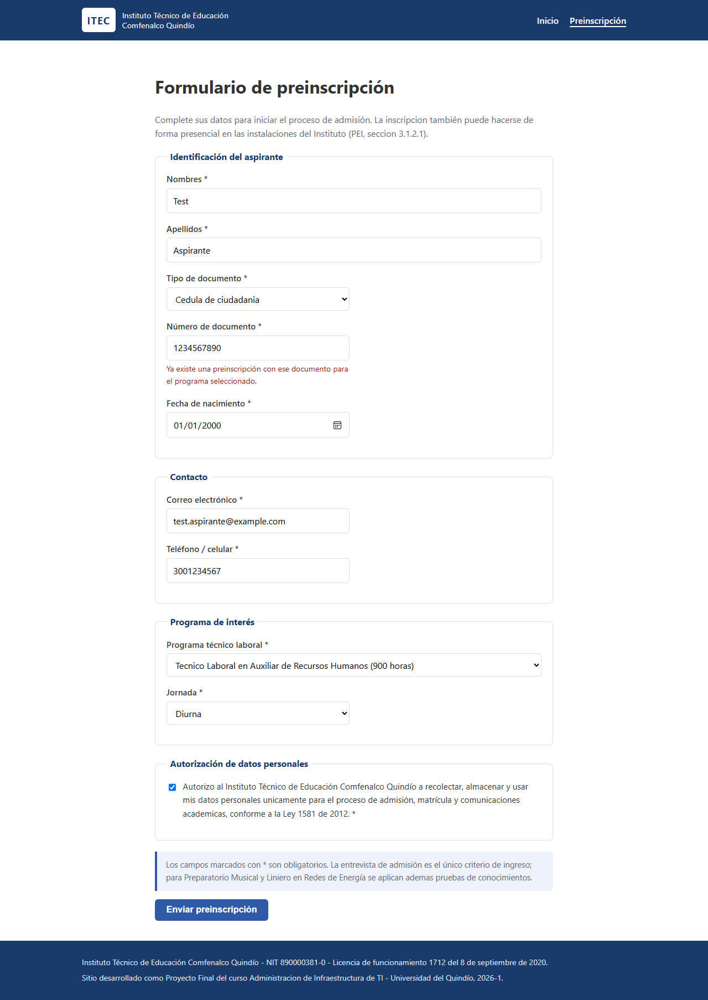
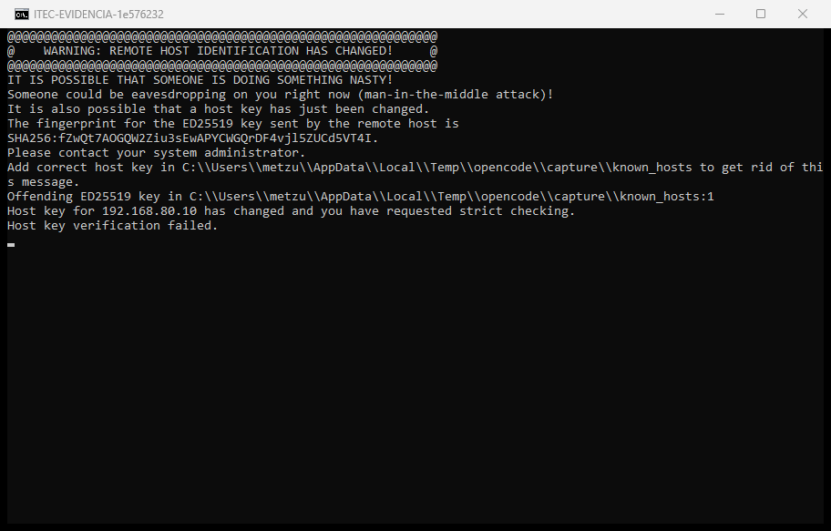
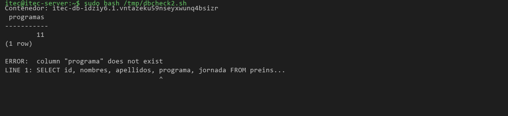
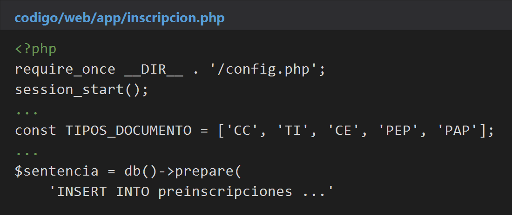
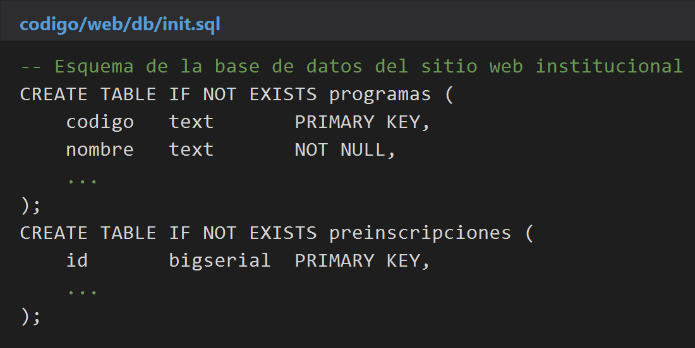

# Parte 2: Sitio web institucional y base de datos PostgreSQL

Proyecto Final — Administración de Infraestructura de TI

Instituto Técnico de Educación Comfenalco Quindío · Universidad del Quindío · 2026-2

Jack Alejandro Marín Hernández

<!--
Notas: abrir diciendo que solo se sustenta la parte 2. No nombrar los otros servicios ni las otras fases; decir únicamente que el resto lo presentan los compañeros en sus espacios. No decir que se está ejecutando algo en vivo: mostrar las capturas reales del equipo.
-->

---

## Alcance de mi exposición

| Entregable de la parte 2 | Criterio de la guía | Puntos |
|---|---|---:|
| Sitio web institucional | Accesible por HTTPS con contenido relevante | 10 |
| Base de datos PostgreSQL | Creada y conectada a la aplicación web | 5 |

**Archivos que la respaldan**

`codigo/web/` · `capturas/05_web/` · `capturas/06_bd/` · secciones 5 y 6 de `documentacion.md`

<!--
Notas: decir "mi exposición se limita a la parte 2; el resto lo presentan mis compañeros". No entrar en detalles de infraestructura, redes ni otros servicios.
-->

---

## Flujo de la aplicación

| Paso | Componente | Función |
|---|---|---|
| 1 | Navegador | Solicita el sitio por HTTPS |
| 2 | Plataforma de despliegue | Publica el contenedor de la aplicación |
| 3 | PHP en `codigo/web/app/` | Sirve las páginas y procesa el formulario |
| 4 | PostgreSQL | Almacena la preinscripción |

<!--
Notas: explicar solo el recorrido de una petición hasta la base de datos. No explicar cómo se instaló la plataforma ni cómo se configuró el dominio; eso pertenece a otro espacio de la presentación.
-->

---

## Sitio web institucional

 

Contenido tomado del PEI: programas técnicos, admisión, matrícula y datos de contacto del instituto.

<!--
Notas: las dos capturas están en fila y con tamaño fijo. Señalar la URL con HTTPS y decir que los programas mostrados son los reales del instituto, eso cumple el criterio de contenido relevante.
-->

---

## Formulario de preinscripción



El formulario recoge los datos del aspirante y los envía a la base de datos.

<!--
Notas: explicar qué hace el formulario sin entrar en la implementación del servidor web. La imagen es un recorte de la captura real de 05_web.
-->

---

## Prueba de integración con la base de datos



El mensaje de éxito confirma que la inserción se completó correctamente desde la web.

<!--
Notas: este es el punto clave de la parte 2. Decir "el registro exitoso es la evidencia de que la aplicación y la base de datos están conectadas". No ejecutar nada en vivo.
-->

---

## PostgreSQL en la plataforma de despliegue



La base de datos aparece creada y en ejecución en el panel de la plataforma.

<!--
Notas: mostrar únicamente el estado de la base. No hablar de la instalación de la plataforma ni de contenedores del sistema; solo decir que la base está disponible para la aplicación.
-->

---

## Tablas y esquema



El esquema está definido en `codigo/web/db/init.sql` y se aplicó al crear la base.

<!--
Notas: señalar que las tablas son las del formulario de preinscripción. No enumerar otras bases ni servicios externos.
-->

---

## Código de la parte 2

| Archivo | Función |
|---|---|
| `codigo/web/app/index.php` | Página de inicio y oferta académica |
| `codigo/web/app/inscripcion.php` | Recepción y guardado del formulario |
| `codigo/web/app/config.php` | Parámetros de conexión a la base |
| `codigo/web/db/init.sql` | Creación del esquema |
| `codigo/web/Dockerfile` | Construcción de la imagen de la aplicación |
| `codigo/web/docker-compose.yml` | Levantamiento reproducible de app y base |

<!--
Notas: esta lámina enumera los archivos que forman la aplicación. En las dos siguientes se muestran fragmentos visuales de dos de ellos.
-->

---

## Código del formulario



La validación y el guardado de la preinscripción están implementados en PHP.

<!--
Notas: decir que es un fragmento real de codigo/web/app/inscripcion.php y que produce el registro exitoso ya mostrado. No nombrar otros servicios.
-->

---

## Código del esquema



Las tablas que reciben la preinscripción están definidas en SQL.

<!--
Notas: decir que es un fragmento real de codigo/web/db/init.sql. No nombrar otros servicios.
-->

---

## Verificación documentada

```bash
docker exec -it <contenedor_db> psql -U itec_app -d itec -c "\dt"
```

Este comando está registrado en la sección 6 de `documentacion.md` como forma de comprobar las tablas.

<!--
Notas: aclarar que es el comando documentado por el equipo, no algo que se vaya a ejecutar ahora. Decir que la evidencia de su resultado es la captura de tablas ya mostrada.
-->

---

## Evidencias y cierre de la parte 2

| Criterio | Evidencia |
|---|---|
| Sitio HTTPS con contenido real | `capturas/05_web/01_home_https.png` y `02_oferta_programas.png` |
| Formulario funcional | `capturas/05_web/03_formulario.png` y `04_registro_exitoso.png` |
| Base creada y conectada | `capturas/06_bd/01_dokploy_db_running.png` y `02_tablas.png` |

**Con esto sustento la parte 2: sitio institucional publicado y base de datos conectada a la aplicación.**

<!--
Notas: cerrar sin mencionar otros servicios. Si preguntan por algo que no es de la parte 2, responder que lo expone el compañero responsable. Gracias.
-->
